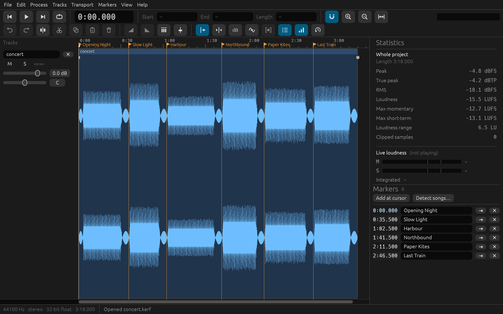

# Kerf

A fast, precise, cross-platform audio editor written in Rust (Windows, macOS, Linux).
Focused purely on editing: no plugins or effects, just careful, non-destructive editing. Built
for turning live recordings into finished albums, with a command-line tool and an MCP server so
scripts and AI assistants can do the same work.



**Status:** early development. There are no releases yet, so build from source (below). CI builds
and tests every change on Linux, Windows and macOS, but day-to-day use so far has been on Linux,
and playback hasn't been tried on many audio devices. Song detection is tuned on synthetic
recordings; reports from real concerts are very welcome. See [ROADMAP.md](ROADMAP.md) for what's
done, what's next, and known limitations.

## Highlights

- **32-bit float end to end.** All audio is held as 32-bit float at the project rate. Nothing is
  quantized until you export, so gain changes and normalization never clip internally, and float
  export keeps peaks above 0 dBFS. 32-bit float WAV round-trips bit-exactly.
- **Non-destructive and sample-exact.** Clips reference immutable source audio. Splitting anywhere,
  or cutting and pasting back, renders bit-identical audio. Fades are anchored to the source, so
  splitting inside a fade is inaudible.
- **Unlimited undo/redo.** Every edit is one undoable step, including fader drags (merged into one
  step). Snapshots share audio, so history costs almost no memory.
- **Normalization.** Peak (dBFS), RMS, or integrated loudness (ITU-R BS.1770 / EBU R128 LUFS,
  checked against EBU Tech 3341). Optional peak ceiling. Per track or linked (keeps the balance).
  Works on a selection or whole tracks.
- **Rendering and track splits.** Export the mix or a selection; split an album recording into one
  file per region between markers; export each track as a stem; or render a track in place to
  consolidate edits. WAV (16/24/32-bit PCM or 32-bit float) or FLAC output; split files named from a
  template such as `{nn} - {title}` or `{artist} - {album}/{nn} {title}`. Dither is TPDF, optionally
  noise-shaped (light, or psychoacoustic "strong") for 16-bit; silence and audio that is already
  exact at the target depth are left untouched, so unedited 16-bit audio exports bit-identical.
- **Song markers for live recordings.** *Markers → Detect Song Starts…* finds where each song
  begins in a concert recording. Live recordings have no silence between songs (applause, crowd,
  talking), so Kerf looks for where the *music* stops and starts, using loudness relative to the
  show's own song level and how noise-like the sound is. A quiet passage inside a song is not
  mistaken for a gap. If you know how many songs there were, say so and the strongest gaps win.
  Paste a setlist to name the tracks, preview the markers live, then export with *Export Split at
  Markers* or *Export Mix with CUE Sheet* (one gapless WAV plus a `.cue` file). Spoken
  introductions stay with the song they introduce. Re-running replaces only automatic markers.
  Songs that flow into each other without a gap need a marker by hand.
- **CD-safe track boundaries.** Split and CUE exports can snap each track boundary to a CD sector
  (1/75 s, moving it at most 6.7 ms; your markers stay put) and pad only the end of the album, so
  there are no sector boundary errors: tracks burn gaplessly as separate files or from the CUE
  sheet. The export dialog shows how many boundaries would otherwise be affected. Works at any rate
  that is a multiple of 75 Hz (44.1, 48, 88.2, 96 kHz): those sectors convert exactly to CD sectors.
  *Markers → Snap Markers to CD Sectors* moves the markers themselves.
- **Export presets and conversion.** *Audio CD* sets 16-bit, 44.1 kHz stereo, noise-shaped dither and
  CD-safe boundaries in one click, from a project at any rate; *Archive* keeps 32-bit float at the
  project rate. Any export can convert sample rate (high-quality resampling) and channels (mono ↔
  stereo). Split exports render and convert the whole album in one pass and cut it at the
  converted boundaries, so resampled tracks still join seamlessly.
- **Editing.** Cut/copy/paste (insert, overwrite, or mix), delete (close gap), silence (leave gap),
  trim to selection, insert silence, split, move and trim clips with snapping, clip gain,
  track gain/pan/mute/solo, and markers. Panning uses a constant-power law (−3 dB at centre) for
  mono material and a balance control for stereo material.
- **Fades and crossfades.** Drag the handles at the top corners of any clip to set its fade-in
  and fade-out, or fade over a selection with I / O (works across clip boundaries). Four curve
  shapes. Where clips on a track overlap after a move or trim, an equal-power crossfade is added
  automatically and follows the overlap as you edit; fades you made yourself are never replaced.
  Toggle under *Process → Automatic crossfades*.
- **Import.** WAV, FLAC, MP3, OGG/Vorbis, AIFF, CAF, M4A/AAC, ALAC with the built-in decoder
  (Symphonia). If [FFmpeg](https://ffmpeg.org) is installed, Kerf also uses it for what the
  built-in decoder can't do fully: HE-AAC at full quality (common for radio recordings; without
  FFmpeg it imports at the right speed but without its upper frequencies, and Kerf says so),
  AC-3/E-AC-3, WMA, APE, WavPack, DTS and more. FFmpeg is found on the PATH automatically; choose
  another or turn it off in *Preferences → Decoding*, or with `KERF_FFMPEG=/path/to/ffmpeg` or
  `KERF_FFMPEG=off` for the CLI and MCP server. Files are resampled with a high-quality FFT
  resampler when their rate differs from the project's.
- **Small memory footprint.** Imported audio is decoded once into a disk cache and memory-mapped,
  so RAM use doesn't grow with the length of your material: a 20-minute stereo 32-bit float file
  adds about 20 MB (waveform overview data), against about 490 MB when held in memory. Pages of
  audio that playback, export or analysis have read are handed back to the system as they go, so
  even playing through a 42-minute recording keeps Kerf at about 250 MB in total. Reopening
  a project maps the cache directly, with no decoding. Playback renders about 0.25 s ahead on its
  own thread, so disk reads never reach the real-time audio thread, and stop, seek and edits still
  take effect at once.
- **Albums.** *File → Album…* (Ctrl+Shift+A) holds the album details and cover, lists every track
  with its title, length, loudness and peak, and sets **album loudness**: one gain for the whole
  album to reach a target (e.g. -16 LUFS for live music) under a peak ceiling, so quiet songs stay
  quieter than loud ones. Export as **tagged FLAC** (the *Lossless album* preset): titles, track
  numbers, artist (with per-track overrides), album, year, genre and cover art. FLAC is written
  frame by frame, so even a two-hour single-file album uses little memory; tracks stay gapless. CUE
  sheets include performer, date, genre and ISRC.
- **Precision editing.** Type exact times in the toolbar's Position, Start, End and Length fields
  (right-click for the time format: m:ss.mmm, seconds, samples or CD frames mm:ss:ff). Drag the
  selection's edges to adjust it. Double-click between markers to select that song. Optionally snap
  selection edges and splits to zero crossings to avoid clicks (Edit menu; Shift+Z moves the current
  selection). Vertical zoom (Ctrl+↑/↓ or Alt+wheel) and a dB waveform scale (D) reveal quiet detail;
  each track can be made taller or shorter on its own.
- **Crash recovery.** Unsaved work is snapshotted every minute (configurable). If Kerf doesn't close
  normally, it offers to recover the work on the next start. Snapshots are tiny: audio is
  referenced, and rendered audio stays in the cache.
- **Panels** (*View* menu), side by side on the right:
  - **Markers** (Ctrl+Shift+M): every marker in a list. Jump to it, rename it in place, select the
    song from one marker to the next, or delete it.
  - **Statistics** (Ctrl+Shift+I): peak, true peak (BS.1770), RMS, integrated loudness, loudest
    momentary and short-term loudness, loudness range (EBU Tech 3342) and clipped samples of the
    selection or the whole project, measured in the background as you edit. A live meter shows
    momentary, short-term and integrated loudness while playing.
  - **History** (Ctrl+Shift+H): every undo step; click one to go back or forward to it.
- **Keyboard shortcuts** can be changed in *Edit → Keyboard Shortcuts…*: press keys to add one,
  reset one command or all. Menus and tooltips always show the keys as bound.
- **Audio device and preferences** (*Edit → Preferences…*, Ctrl+,): output device, buffer size,
  Space behaviour, preview length and recovery interval. Stored in the platform config folder
  (`KERF_CONFIG_DIR` overrides it).
- **Projects** (`.kerf`) are JSON plus references to your audio files. Rendered material is
  saved beside the project as 32-bit float WAV.

## Building

Requires Rust 1.100 (pinned by `rust-toolchain.toml`; rustup installs it automatically). Windows and macOS need nothing
else. On Linux, install the audio and font development libraries first:

```sh
sudo apt install pkg-config libasound2-dev libfontconfig1-dev libxkbcommon-dev libwayland-dev  # Debian, Ubuntu
sudo dnf install pkgconf-pkg-config alsa-lib-devel fontconfig-devel libxkbcommon-devel wayland-devel  # Fedora
```

```sh
cargo run --release -p kerf              # launch
cargo run --release -p kerf -- song.wav  # open files / a .kerf project
cargo run --release -p kerf-cli -- --help
cargo test --workspace
```

### Audio cache

Decoded audio lives in `~/.cache/kerf/audio` (Linux), `~/Library/Caches/kerf/audio` (macOS) or
`%LOCALAPPDATA%\kerf\audio` (Windows). Set `KERF_CACHE_DIR` to put it elsewhere, such as a fast
drive. Entries are re-created automatically if a source file changes, and are deleted after 30 days
unused. *File → Audio Cache…* shows its size and frees everything the open project (including its
undo history) isn't using. The cache can always be deleted safely. It uses about the same space as the audio at
32-bit float (about 1.4 GB per hour of stereo at 48 kHz). If no cache folder can be created, Kerf
falls back to keeping audio in memory.

## Command line

`kerf-cli` runs the same engine without the GUI, for batch work and scripts. Every command prints
a readable report, or one JSON document per input with `--json`. Nothing is overwritten without
`--force`, `--dry-run` shows exactly which files would be written, and a failed run exits non-zero.

```sh
# A live show to a finished album: find 14 songs, name them from the setlist, tag, level the
# whole album to -16 LUFS, and write CD-ready tracks plus a gapless image with a CUE sheet.
kerf-cli split show.wav --songs 14 --setlist setlist.txt --artist "The Band" --album "Live" \
    --loudness -16 --preset cd --cue --out album/ --save show.kerf

kerf-cli detect show.wav --songs 14                 # just list the song starts
kerf-cli analyze *.wav                              # peak, true peak, RMS, LUFS, range and clipping per file
kerf-cli info show.kerf                             # tracks, clips, markers, album details
kerf-cli export *.flac --preset cd --out cd/        # batch convert
kerf-cli export show.kerf --kind tracks --preset flac --out flac/ --dry-run
kerf-cli export show.kerf --kind tracks --preset flac --out music/ \
    --names "{artist} - {album} ({year})/{nn} {title}"   # file names, with folders
kerf-cli waveform show.kerf -o show.png --db        # a picture: peaks, RMS, clipping, markers
kerf-cli run --ops edits.jsonl show.wav             # any operation, as JSON
```

Times are seconds (`83.5`), `m:ss` (`1:23.5`), `h:mm:ss`, or exact samples (`4008000smp`).
`kerf-cli run` accepts any engine operation (open, import, save, undo/redo, split, delete, clear,
crop, copy/cut/paste, gain, normalize, fades, markers, album details and loudness, export) as a
JSON array or one object per line, e.g. `{"op": "fade_out", "start": "41:10", "end": "41:18"}`.
These are the operations of `kerf_core::ops`, which the MCP server exposes too.

## AI assistants (MCP)

`kerf-mcp` is a [Model Context Protocol](https://modelcontextprotocol.io) server, so an assistant
such as Claude can open, inspect, edit and export audio with Kerf. Add it to your client's MCP
configuration, naming the folders it may use:

```json
{
  "mcpServers": {
    "kerf": { "command": "kerf-mcp", "args": ["--allow", "/home/me/Music"] }
  }
}
```

- **Tools:** every engine operation (the same as `kerf-cli run`), generated from the operation
  types so they always match. Each returns a one-line summary plus details as JSON.
- **Seeing audio:** an assistant can't listen, so `waveform` returns a picture of any range
  (zoom in by choosing start and end), and `analyze`, `find_silences` and `detect_songs` report
  levels and positions.
- **Safe by design:** every edit is one undoable step; `open` and `new` won't drop unsaved changes
  unless asked; exports never overwrite without `force`, and dry runs show exactly what would be
  written; files are only read or written inside the `--allow` folders (default: the folder it
  was started in).
- **In the app, while you watch:** turn on *Preferences → Assistant (MCP)* and configure your
  client with `{"command": "kerf-mcp", "args": ["--app"]}` (Preferences shows the exact line, with
  a Copy button). The assistant then works on the project you have open: each edit appears on the
  timeline at once and is one undo step labelled "AI: …". Its operations run on a snapshot in the
  background and are applied between your own edits, never during a drag, so you can keep working,
  undo anything, or press *Disconnect* in the status bar. It can't open or close projects there.
  Only programs you run can connect (a local connection with a secret token only you can read).
- **Resources:** `kerf://project`, `kerf://markers`, `kerf://history`. **Prompt:**
  `prepare_live_album` walks through detecting, checking, naming, levelling, tagging and
  exporting a concert. Long operations report progress and can be cancelled.

## Layout

| Crate | Purpose |
|---|---|
| `crates/kerf-core` | UI-free engine: model, edits, undo, mixing, analysis, I/O, projects. Fully unit-tested. |
| `crates/kerf-app`  | Desktop app (egui/eframe), real-time playback (cpal). |
| `crates/kerf-cli`  | `kerf-cli` command-line tool on the `kerf_core::ops` operations layer. |
| `crates/kerf-mcp`  | `kerf-mcp` MCP server (stdio) on the same operations. |

`cargo run -p kerf-core --example demo_project -- <dir>` generates a demo project that exercises
most features.
`cargo run --release -p kerf-core --example live_show -- show.wav` generates a synthetic concert
for trying song-start detection.

## Keyboard

| Key | Action | Key | Action |
|---|---|---|---|
| Space | Play / stop (returns to start) | Shift+Space | Stop at the playhead |
| P | Preview around the cursor | Shift+L | Toggle loop |
| L / J | Play forwards / backwards; press again for 2×, 4×, 8× | K | Stop at the playhead |
| K+L / K+J (hold) | Play forwards / backwards at half speed | Ctrl+drag ruler | Scrub |
| ← / → | Nudge cursor (skip 5 s while playing) | Shift+← / → | Extend selection |
| Ctrl+← / → | Previous / next edit point (clip edge, marker) | Ctrl+Shift+← / → | Extend to edit point |
| ↑ / ↓ | Previous / next track (Shift adds) | Home / End | Start / end (Shift extends) |
| [ / ] | Selection start / end | PgUp / PgDn | Scroll a screen |
| S | Split at cursor (or selection edges) | Del / ⌫ | Delete, close gap |
| Ctrl+X / C / V | Cut / copy / paste | Ctrl+L | Silence, keep gap |
| Ctrl+Z / Ctrl+Shift+Z | Undo / redo | Ctrl+T | Trim to selection |
| Ctrl+M | Normalize | Ctrl+G | Gain |
| I / O | Fade in / out over selection | Ctrl+R | Render track in place |
| M | Add marker | , / . | Previous / next marker |
| + / − / Z | Zoom in / out / to selection | Ctrl+F | Zoom to fit |
| Ctrl+Shift+M | Markers panel | Ctrl+, | Preferences |
| Ctrl+Shift+I | Statistics panel | Ctrl+Shift+H | History panel |
| Ctrl+Shift+A | Album details and loudness | | |
| N | Toggle snap | Ctrl+E / Ctrl+Shift+E | Export mix / split at markers |
| Ctrl+↑ / ↓ | Vertical zoom | D | Waveform in dB |
| Shift+Z | Selection to zero crossings | Double-click | Select clip, or song between markers |
| Alt+↑ / ↓ | Taller / shorter tracks (selected, or all) | Ctrl+Shift+O | Open a recent project |

These are the defaults: change any of them in *Edit → Keyboard Shortcuts…*. Space and
Shift+Space can be swapped in Preferences. J/K/L work like the shuttle keys of video
editors: speed changes the pitch, as with tape.

Mouse: drag in a track to select time (across tracks). Drag a clip's title bar to move it, even to
another track. Drag clip edges to trim. Drag the small squares at a clip's top corners to set its fades
(right-click the clip to change the curve or remove them). Hold Alt to disable snapping. Ctrl+wheel zooms, Shift+wheel
scrolls. Drag the ruler to select across all tracks. **Scrub** by dragging the playhead (or the
cursor's handle at the bottom of the ruler), or Ctrl+drag anywhere in the ruler: the sound follows
the mouse like tape under your hand, backwards too, and falls silent when you hold still. If
playback was running it carries on from where you let go. Double-click a marker to rename it.
Drag the line under a track (in its header or waveform) to change its height; hold Ctrl to resize
every track, double-click the line to reset it. *View → Fit Tracks to Window* shares the space
evenly.
Drag and drop files onto the window.

## Contributing

Bug reports, real-world recordings that trip up song detection, and pull requests are welcome.
See [CONTRIBUTING.md](CONTRIBUTING.md) for how to build, test and send changes.

## Security

Please report vulnerabilities privately, as described in [SECURITY.md](SECURITY.md), not in a
public issue.

## License

Licensed under either of [Apache License, Version 2.0](LICENSE-APACHE) or
[MIT license](LICENSE-MIT) at your option.

Unless you explicitly state otherwise, any contribution intentionally submitted for inclusion in
Kerf by you, as defined in the Apache-2.0 license, shall be dual licensed as above, without any
additional terms or conditions.
